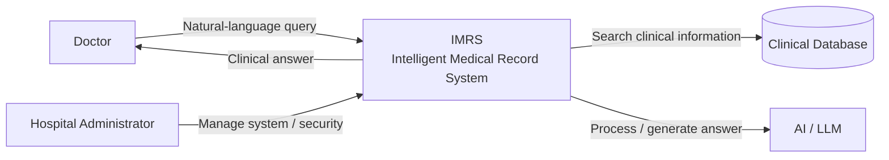

# LAB 2 — ARCHITECTURE DIAGRAMS

## 1. Lab Information

- System: Intelligent Medical Record System (IMRS)
- Lab: Lab 2 — Architecture Diagrams
- Main topic: Architecture Design and Building Blocks
- Diagram notation: Mermaid (context diagram) and PlantUML (architecture, interaction, and responsive design diagrams)
- Related Lab: Lab 1 — Architecture Baseline

---

## 2. Objectives

The objectives of Lab 2 are:

- Represent the IMRS architecture using architecture diagrams.
- Identify the main building blocks of the system.
- Show the relationships between users, applications, databases,
  AI services and other system components.
- Make the architecture easier to understand and communicate.
- Connect the diagrams with the architectural drivers and ASRs
  identified in Lab 1.

---

## 3. System Overview

The Intelligent Medical Record System (IMRS) is an AI-assisted
clinical search system.

The main user is a doctor. The doctor can enter a natural-language
query and the system processes the query, searches the relevant
clinical knowledge and returns the result.

The architecture contains several major areas:

- User Interface
- Application / Backend
- Authentication and Access Control
- Query Processing
- Retrieval / Search
- Knowledge and Clinical Data
- AI / LLM
- Response Generation

The architecture should also consider the constraints and ASRs
identified in Lab 1.

---

# 4. System Context Diagram

The System Context Diagram provides a high-level view of IMRS
and the external actors or systems interacting with it.

## 4.1 Main Actors

### Doctor

The doctor is the main user of the system.

The doctor:

- enters a natural-language query;
- sends the query to IMRS;
- receives the generated answer;
- uses the answer to support clinical information retrieval.

### Hospital Administrator

The hospital administrator is responsible for system-level
management and security requirements.

### Clinical Database

The clinical database contains internal clinical information
used by the system.

### AI / LLM Service

The AI component processes natural-language queries and generates
the final response.

---

## 4.2 System Context Diagram

---

# 5. Layered View

The layered view shows the main IMRS responsibilities and their dependencies,
from the presentation layer down to external data stores and AI services.

PlantUML source: [01_layered_view.puml](diagrams/01_layered_view.puml)

---

# 6. Record Ingestion Class Diagram

The class diagram describes record parsing, text redaction, and the medical
entities produced during ingestion.

PlantUML source: [02_class_diagram.puml](diagrams/02_class_diagram.puml)

---

# 7. Data Model

The data model shows the patient, medical record, and AI log entities,
including their primary/foreign keys and one-to-many relationships.

PlantUML source: [03_data_model.puml](diagrams/03_data_model.puml)

---

# 8. C4 Container View

The container view shows the browser application, backend API, data stores,
and external AI service, along with the main user interactions.

PlantUML source: [04_c4_container.puml](diagrams/04_c4_container.puml)

---

# 9. MVC Architecture

The MVC view maps the user-facing views and controller to the model services
that authorize requests, ingest records, retrieve clinical context, and
generate answers.

PlantUML source: [05_mvc_architecture.puml](diagrams/05_mvc_architecture.puml)

---

# 10. Client-Server Architecture

The client-server view separates browser responsibilities from application
server processing, data stores, and the external AI service.

PlantUML source: [06_client_server.puml](diagrams/06_client_server.puml)

---

# 11. Responsive Web Design

The responsive design view summarizes how search and result layouts adapt
across wide, medium, and narrow viewports.

PlantUML source: [07_responsive_design.puml](diagrams/07_responsive_design.puml)