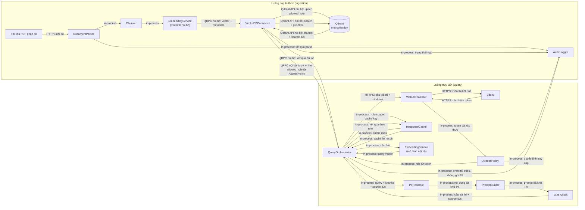
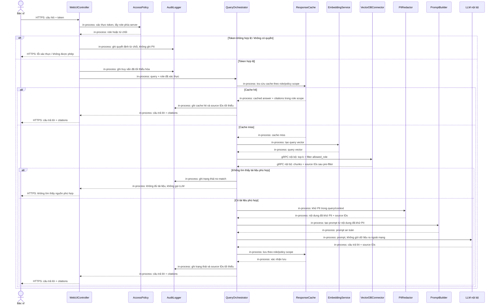

# LAB 4 - RAG Architecture Design

## 1. Scope and evidence

This draft uses the Lab 4 assignment text, the available [Lab 1 report](../lab1/LAB1_REPORT.md), and the decisions confirmed for this draft:

- D1: Qdrant self-hosted.
- D2: open-source embedding model hosted internally.
- D3: pre-filter by `allowed_role` in one collection.

The repository's `context-pack.md` and `AI_LOG.md` are empty directories, not populated files. The available Lab 1 report is an incomplete baseline: it describes requests, analysis, retrieval, responses, and a modular architecture, but it does not define RAG-specific ASRs, TTFT targets, or detailed privacy/retention rules. Do not treat unprovided details as approved requirements. Confirm the missing constraints with the team before implementation.

The assignment gives a corpus of 5,000 internal PDFs. The P2B prompt separately mentions one RTX 4090, a USD 15,000 budget, and a four-month schedule; verify that those figures apply to this team's design. No performance threshold is assumed.

## 2. Task 1 - Architectural drivers

Priorities are draft recommendations, not priorities recorded in Lab 1. “AI đề xuất” rows require student review; assignment-derived rows should be checked against the original lab brief.

| Mã | Nhóm | Mô tả | Liên quan ASR/ràng buộc nào của Lab 1 | Mức ưu tiên | Nguồn |
|---|---|---|---|---|---|
| DRV-01 | Functional | Nạp, phân tích, chia đoạn và lập chỉ mục cho kho 5.000 PDF nội bộ. | Lab 1 §3, §5: nhận và xử lý dữ liệu; quy mô 5.000 PDF do đề Lab 4 nêu, chưa có trong Lab 1. | High | Đề Lab 4; cần SV xác nhận phạm vi tài liệu |
| DRV-02 | Functional | Hỗ trợ tra cứu ngữ nghĩa trên hai loại tài liệu: phác đồ dành cho bác sĩ và hướng dẫn dành cho bệnh nhân. | Lab 1 §4 có User/Admin nhưng chưa phân loại tài liệu; vai trò/tài liệu lấy từ đề Lab 4. | High | Đề Lab 4 |
| DRV-03 | Functional | Trả lời câu hỏi bằng ngữ cảnh được truy xuất và cung cấp trích dẫn đến tài liệu nguồn. | Lab 1 §3, §5 mô tả truy xuất dữ liệu và tạo câu trả lời; trích dẫn là yêu cầu thiết kế RAG cần xác nhận. | High | AI đề xuất – SV cần xác nhận trích dẫn là yêu cầu |
| DRV-04 | Functional | Ghi nhận truy vấn, quyết định phân quyền, tài liệu được truy xuất và trạng thái trả lời để phục vụ kiểm toán; tránh ghi PII không cần thiết. | Lab 1 §4 nêu Admin, nhưng chưa định nghĩa audit, nội dung log hay retention. | Medium | AI đề xuất – SV cần xác nhận chính sách audit/retention |
| DRV-05 | Quality (performance) | Giảm độ trễ đến token đầu tiên (TTFT) trên luồng truy vấn RAG. Chưa có ngưỡng TTFT được phê duyệt; cần đo và đặt mục tiêu. | Lab 1 không nêu TTFT hoặc ngưỡng độ trễ. | High | Yêu cầu bắt buộc trong đề P1; thiếu ngưỡng |
| DRV-06 | Quality (security) | Chỉ truy xuất tài liệu phù hợp với vai trò đã xác thực; xác định vai trò phía máy chủ từ token, không tin vai trò client gửi lên. | Lab 1 §4 phân biệt User/Admin nhưng không có mô hình RBAC chi tiết. | Critical | Đề Lab 4; cần SV đối chiếu với phân quyền Lab 1 |
| DRV-07 | Quality (confidentiality) | Tài liệu, embedding, truy vấn, ngữ cảnh và câu trả lời không rời mạng nội bộ. | Lab 1 không ghi rõ data residency. Đây là ràng buộc nêu trong đề P1/P3. | Critical | Đề Lab 4 |
| DRV-08 | Quality (privacy) | Thực hiện `PIIRedactor` trước khi gửi ngữ cảnh đến LLM; theo ràng buộc hiện tại, LLM cũng phải chạy nội bộ. | Lab 1 không nêu quy tắc khử PII hoặc vị trí LLM. | Critical | Đề Lab 4 |
| DRV-09 | Quality (modifiability) | Có thể thay mô hình embedding mà không viết lại nghiệp vụ truy vấn/kho vector; quản lý phiên bản mô hình và tái lập chỉ mục khi chiều/không gian vector thay đổi. | Lab 1 §3 yêu cầu kiến trúc module, có thể mở rộng AI; chi tiết embedding chưa có trong Lab 1. | High | Đề P1 + AI đề xuất – SV cần xác nhận quy trình re-embedding |
| DRV-10 | Constraint | Dùng Qdrant tự triển khai và một collection với metadata `allowed_role`, theo quyết định D1/D3 của nhóm cho bản nháp này. | Không phải ràng buộc Lab 1; đây là quyết định nhóm được cung cấp cho bản nháp. | High | Quyết định nhóm |
| DRV-11 | Constraint | Ưu tiên mô hình embedding mã nguồn mở chạy nội bộ. | Không có lựa chọn embedding cụ thể trong Lab 1. | High | Quyết định nhóm; cần chọn model và kiểm tra phần cứng |
| DRV-12 | Constraint (tentative) | Nếu P2B là bối cảnh chính thức của nhóm: thiết kế trong giới hạn 1 GPU RTX 4090, USD 15.000 và bốn tháng. | Không có trong Lab 1; các con số chỉ xuất hiện trong prompt P2B. | High, pending confirmation | Đề P2B; SV cần xác nhận có áp dụng |

### Đối chiếu với Lab 1

- **Được hỗ trợ một phần:** nhận yêu cầu, xử lý, truy xuất dữ liệu, tạo câu trả lời và thiết kế module (Lab 1 §3, §5).
- **Chưa có trong Lab 1:** TTFT/SLO, 5.000 PDF, phân quyền theo loại tài liệu, khử PII, data residency, trích dẫn, audit/retention, lựa chọn Qdrant/embedding và ngân sách/phần cứng.
- Trước khi nộp, SV cần kiểm tra mỗi dòng với bản Lab 1 đầy đủ và cập nhật cột “Nguồn” thành “AI đề xuất – giữ nguyên”, “AI đề xuất – SV sửa”, hoặc “SV bổ sung”. Không đánh dấu kết quả kiểm chứng chéo là đã hoàn tất nếu chưa thực hiện.

## 3. Task 2 - Compare decisions D1, D2, D3

### Assumptions

1. Tài liệu RAG và truy vấn là dữ liệu nội bộ; không được gửi sang dịch vụ đám mây.
2. Role được xác định và kiểm tra trên máy chủ từ token hợp lệ. Metadata trong vector store là một lớp lọc bổ sung, không thay thế xác thực/ủy quyền ở backend.
3. Qdrant self-hosted means the database is operated inside the hospital network. Backups, telemetry, model downloads, and operational access must also be checked for egress.
4. No benchmark, cost quote, model selection, or latency target has been provided. Those must be measured or obtained from the relevant vendors.

### D1 - Vector store

| Tiêu chí / driver | (a) Qdrant tự triển khai nội bộ | (b) pgvector trên PostgreSQL sẵn có | (c) Vector DB đám mây được quản lý |
|---|---|---|---|
| Độ trễ / DRV-05 | Không có số đo cho workload này; cần benchmark ingestion, filter và truy vấn trên hạ tầng thật. | Có thể tận dụng hạ tầng PostgreSQL hiện hữu theo giả định; chưa có benchmark hoặc cấu hình DB. | Phụ thuộc mạng, vùng triển khai và workload; cần benchmark. |
| Bảo mật / DRV-06–08 | Có thể đặt trong mạng nội bộ theo quyết định triển khai; backend vẫn phải xác thực role và luôn áp dụng filter. Qdrant hỗ trợ điều kiện filter trên payload khi query ([Filtering](https://qdrant.tech/documentation/search/filtering/)). | Có thể chạy trên PostgreSQL nội bộ nếu hạ tầng hiện tại đáp ứng. pgvector mô tả filtering với approximate index là sau bước scan; xem thêm D3 ([pgvector: Filtering](https://github.com/pgvector/pgvector#filtering)). | Mặc định dịch vụ cloud đặt dữ liệu trên hạ tầng do nhà cung cấp quản lý; không phù hợp ràng buộc “dữ liệu không rời mạng nội bộ”, trừ mô hình triển khai private/hybrid được phê duyệt. Qdrant mô tả khác biệt vị trí dữ liệu giữa Managed, Hybrid và Private Cloud ([About Qdrant Managed Cloud](https://qdrant.tech/documentation/cloud/)). |
| Chi phí | Tự vận hành cần nhân lực, tính toán, lưu trữ, backup và khôi phục; chưa có báo giá. | Có thể giảm số hệ quản trị riêng nếu DB hiện hữu phù hợp; cần kiểm tra extension, dung lượng, tải và ảnh hưởng workload. Không kết luận tiết kiệm nếu chưa đo. | Phí dịch vụ phụ thuộc nhà cung cấp và cấu hình; cần báo giá. Không có số tiền được giả định. |
| Độ phức tạp vận hành | Nhóm chịu trách nhiệm triển khai, nâng cấp, backup, monitoring và khôi phục. | Một stack có thể giảm số hệ thống cần vận hành, nhưng quản trị PostgreSQL và tuning index vẫn cần thiết. | Nhà cung cấp quản lý một phần vận hành; phải đánh giá IAM, backup, SLA, vùng dữ liệu, egress và phụ thuộc nhà cung cấp. |
| Khả năng thay thế / DRV-09 | Tách `VectorDBConnector` và giao diện truy vấn khỏi nghiệp vụ để đổi store; schema/filter API vẫn tạo chi phí chuyển đổi. | Tương tự cần abstraction; SQL extension không làm cho truy vấn/index tương đương hoàn toàn với store khác. | Phải tính đến API đặc thù, migration/export và chi phí chuyển đổi. |
| Mức phù hợp ràng buộc | **Cao nếu** vận hành nội bộ và quản trị bảo mật/backup được bố trí. | **Có thể phù hợp** nếu PostgreSQL nội bộ hiện hữu đạt yêu cầu và kiểm thử cho thấy lọc/recall chấp nhận được. | **Thấp** với yêu cầu không rời mạng; không chọn trừ khi có phương án triển khai private được duyệt. |

**Khuyến nghị:** Dùng Qdrant tự triển khai nội bộ theo quyết định D1 của nhóm; xác nhận năng lực vận hành và benchmark so sánh với pgvector trước khi chốt sizing.

### D2 - Embedding service

| Tiêu chí / driver | (a) Mô hình mã nguồn mở chạy nội bộ | (b) API embedding của nhà cung cấp cloud |
|---|---|---|
| Độ trễ / DRV-05 | Độ trễ phụ thuộc model, GPU, batch, tải đồng thời và tiền xử lý; phải đo trên GPU thực tế. Không suy diễn rằng một GPU cụ thể đáp ứng SLO. | Độ trễ phụ thuộc mạng, endpoint và tải nhà cung cấp; phải benchmark, không có số liệu trong đề. |
| Bảo mật / DRV-07–08 | Embedding và nội dung có thể ở trong mạng nếu artifact/model và telemetry được tải/quản trị phù hợp. Mô hình vẫn cần kiểm tra license và quy trình cập nhật. | Nội dung được gửi ra endpoint bên ngoài, trái ràng buộc locality. Chính sách phụ thuộc nhà cung cấp; ví dụ tài liệu OpenAI nói dữ liệu API không dùng để huấn luyện mặc định nhưng abuse-monitoring logs có thể giữ nội dung tối đa 30 ngày mặc định, và ZDR cần được phê duyệt ([OpenAI API data controls](https://developers.openai.com/api/docs/guides/your-data)). Không dùng ví dụ này để suy rộng cho nhà cung cấp khác. |
| Chi phí | Không có phí API theo request, nhưng cần tính GPU, điện, lưu trữ, nhân lực vận hành và cập nhật model; cần ước tính thực tế. | Có phí theo bảng giá/request của nhà cung cấp và chi phí truyền dữ liệu nếu có; cần lấy báo giá hiện hành. |
| Độ phức tạp vận hành | Nhóm quản lý model serving, batching, monitoring, cập nhật, rollback và tương thích tokenizer/vector. | Ít vận hành model serving hơn ở phía nhóm theo giả định dùng API chuẩn; vẫn cần quản lý credential, quota, versioning, lỗi mạng và chính sách dữ liệu. |
| Khả năng thay thế / DRV-09 | Đóng gói sau `EmbeddingService` interface; lưu model ID/version, preprocessing, dimension và version metadata để tránh vector không tương thích. | Đóng gói sau cùng interface; API/format/dimension/terms khác nhau theo nhà cung cấp nên cần adapter và re-index khi đổi. |
| Mức phù hợp ràng buộc | **Cao** với yêu cầu nội bộ; khả năng chất lượng/hiệu năng chưa chứng minh cho đến khi đánh giá model. Hugging Face Transformers ghi nhận pipeline có tác vụ feature extraction, nhưng model cụ thể phải được lựa chọn và kiểm chứng ([Pipelines](https://huggingface.co/docs/transformers/main/en/main_classes/pipelines)). | **Thấp** với yêu cầu locality, dù chính sách lưu trữ/huấn luyện của một nhà cung cấp có thể có lựa chọn kiểm soát. |

**Khuyến nghị:** Dùng model mã nguồn mở chạy nội bộ theo quyết định D2; trước khi chốt, đánh giá chất lượng trên tập truy vấn/tài liệu giả lập hoặc đã được phép sử dụng, benchmark trên GPU mục tiêu và kiểm tra license.

### D3 - Authorization filtering

| Tiêu chí / driver | (a) Pre-filter metadata trong truy vấn vector | (b) Post-filter sau truy xuất | (c) Collection riêng theo role |
|---|---|---|---|
| Độ trễ / DRV-05 | Một truy vấn có điều kiện role; hiệu năng phụ thuộc index và phân bố metadata. Cần đo. Qdrant hỗ trợ điều kiện payload trong truy vấn ([Filtering](https://qdrant.tech/documentation/search/filtering/)). | Có thể phải lấy ứng viên rồi loại bỏ kết quả không được phép; nếu lọc làm hụt top-k phải truy xuất thêm hoặc trả ít kết quả. Với pgvector approximate index, tài liệu xác nhận filtering được áp dụng sau index scan và nêu iterative scans như một lựa chọn để quét thêm ([pgvector: Filtering](https://github.com/pgvector/pgvector#filtering)). | Chọn collection theo role có thể thêm bước định tuyến và quản lý collection; hiệu năng phụ thuộc triển khai, chưa đo. |
| Bảo mật / DRV-06–08 | Giảm khả năng đưa tài liệu sai role vào context nếu backend bắt buộc truyền role lấy từ token. Không đủ nếu client tự chọn filter hoặc backend có đường bỏ qua filter. | Rủi ro tài liệu trái quyền xuất hiện trong candidate set nội bộ; lỗi lọc/ghi log/citation có thể gây rò rỉ. Không chọn làm biện pháp duy nhất. | Có thể tách phạm vi lưu trữ theo role, nhưng cần xác thực backend và kiểm soát mapping role→collection; không mặc định collection là ranh giới bảo mật đầy đủ. |
| Chi phí | Ít bản sao dữ liệu hơn so với tách collection; cần tạo/index metadata đúng và kiểm thử mọi truy vấn. | Có thể dễ cài ở tầng ứng dụng nhưng cần xử lý thiếu kết quả, truy xuất bù và bảo đảm không phát tán kết quả trái quyền. | Dễ tăng bản sao, index, cấu hình, backup và đồng bộ khi tài liệu dùng chung nhiều role. |
| Độ phức tạp vận hành | Một collection/schema; cần kiểm thử chính sách và filter bắt buộc tại connector. | Phải kiểm tra mọi đường trả kết quả sau lọc; dễ có sai lệch giữa top-k và số kết quả được phép. | Cần quản lý lifecycle và cập nhật cho từng collection, phân quyền và tài liệu dùng chung. |
| Khả năng thay thế / DRV-09 | Filter nằm trong `VectorDBConnector` adapter; API filter vẫn khác nhau giữa các store. | Logic lọc ở application layer dễ mang đi nhưng tăng trách nhiệm bảo mật của ứng dụng. | Mô hình collection thường phụ thuộc khả năng và API của từng store. |
| Mức phù hợp ràng buộc | **Cao** với Qdrant và quyết định nhóm, nếu role do server xác định và kiểm thử deny-by-default. | **Thấp** cho dữ liệu nhạy cảm nếu không có lớp bảo vệ bổ sung đã được chứng minh. | **Có thể phù hợp** khi cần cô lập mạnh, nhưng chưa có yêu cầu hoặc phân tích vận hành biện minh cho bản nháp này. |

**Khuyến nghị:** Chọn pre-filter trên một collection theo quyết định D3; coi đây là defense-in-depth, luôn xác thực quyền phía backend, áp dụng filter bắt buộc, kiểm tra deny-by-default và audit kết quả.

## 4. Task 2B / 2C - AI testing and cross-check

These are empirical exercises requiring a separate fresh conversation/tool. They have **not** been run or represented as completed in this draft.

| Bài thử | Trạng thái | Cần ghi lại |
|---|---|---|
| P2B: Prompt không nhắc PII/locality; quan sát AI có tự cảnh báo nội dung y tế ra cloud không. | Chưa thực hiện bằng một cuộc trò chuyện độc lập. Bản báo cáo này đã nêu ràng buộc locality nên không phải kết quả thử P2B. | Tên AI/model, ngày, prompt chính xác, cảnh báo có/không, câu trả lời trích dẫn, nhận xét của SV. Nếu không cảnh báo, ghi rõ đây là hạn chế của AI. |
| P2C: Dùng AI thứ hai để kiểm chứng ba khẳng định kỹ thuật. | Chưa thực hiện bằng AI thứ hai. | Ghi tên công cụ/model; dán nguyên văn ba khẳng định; kết quả Đúng/Sai/Chưa đủ căn cứ; sau đó kiểm tra lại từng khẳng định bằng tài liệu chính thức bên dưới. |

### Claims to verify in P2C

1. Qdrant permits payload conditions in search/retrieval queries: [Qdrant Filtering](https://qdrant.tech/documentation/search/filtering/).
2. pgvector approximate-index filtering occurs after index scanning and may return fewer rows; iterative index scans are documented: [pgvector Filtering and Iterative Index Scans](https://github.com/pgvector/pgvector#filtering).
3. Qdrant documents distinct Managed, Hybrid, and Private Cloud deployment models and where data lives for those models: [Qdrant Managed Cloud](https://qdrant.tech/documentation/cloud/). This does **not** by itself prove collection-per-role is an authorization boundary; that is an architectural pattern requiring separate security verification.

## 5. Task 3 - RAG flowchart and sequence

Assumptions: backend derives the role from a validated token; all listed services, vector storage, and the LLM run inside the internal network; `allowed_role` is stored as vector metadata; the response cache key includes the authenticated role/policy scope and is invalidated when the source/policy changes. The diagram does not prescribe a concrete transport between in-process components; it labels those calls `in-process`. `gRPC` labels the vector connector interface as a proposed internal protocol. Audit-log persistence/transport is intentionally unspecified and must be confirmed with the team.

### 5.1 Flowchart



### 5.2 Sequence diagram



### 5.3 Components added or made explicit

| Thành phần | Lý do |
|---|---|
| AccessPolicy | Xác minh token và lấy role ở backend; không tin role do client khai báo. |
| AuditLogger | Lưu quyết định truy cập/kết quả tối thiểu để kiểm tra; chính sách retention và dữ liệu được phép ghi cần SV/nhóm xác nhận. |
| ResponseCache | Tránh tính lại kết quả; key phải giới hạn theo role/policy để không phục vụ cache chéo quyền. |
| PIIRedactor | Đặt trước prompt gửi cho LLM theo ràng buộc; giữ source IDs riêng để tạo citations. |
| DocumentParser, Chunker, EmbeddingService, PromptBuilder, VectorDBConnector | Các thành phần nêu trong sơ đồ khung/được yêu cầu thống nhất tên; embedding chạy nội bộ theo quyết định D2. |

### 5.4 P3B review checklist

| Kiểm tra | Kết quả rà soát mã | Ghi chú |
|---|---|---|
| Tên chuẩn `QueryOrchestrator`, `PIIRedactor`, `VectorDBConnector`, `WebUIController` | Đạt | Tên xuất hiện nhất quán trong flowchart/sequence. |
| PIIRedactor trước LLM | Đạt | Query/context đi qua redactor trước PromptBuilder và LLM. |
| Quyền kiểm tra phía server | Đạt | AccessPolicy đọc token phía server, role đi vào filter; client không gửi role. |
| Mọi mũi tên có nhãn hành động/giao thức | Đạt | Mỗi cạnh và thông điệp có nhãn; `in-process` là giả định giao tiếp nội bộ. |
| Không có thành phần ngoài phạm vi | Đạt | Chỉ dùng thành phần trong sơ đồ khung/TODO và tên chuẩn Lab 2–3. |
| Sequence phân biệt call/return, có no-match | Đạt | Dùng `->>`/`-->>` và nhánh `alt`. |
| Kiểm chứng trên mermaid.live | Đạt | Cả hai khối đã được dán và Mermaid Live Editor hiển thị nhãn/nodes thay vì báo lỗi cú pháp. |

## 6. Task 4 - ADR drafts# LAB 4 – Bộ prompt (dán vào Claude/ChatGPT/Gemini)

Cách dùng: mở `context-pack.md`, copy toàn bộ nội dung thay cho `<dán context-pack.md>`. Mỗi prompt chạy trong một cuộc trò chuyện mới để dễ ghi `AI_LOG.md`. Chỉ dùng dữ liệu giả lập, không dán dữ liệu bệnh nhân thật.

| Prompt | Dùng cho | Dòng AI_LOG |
|---|---|---|
| P1 | Nhiệm vụ 1 – Drivers | 1 |
| P2 | Nhiệm vụ 2 – So sánh D1, D2, D3 | 2 |
| P2B | Nhiệm vụ 2 – Thử AI có tự phát hiện vi phạm PII không | 3 |
| P2C | Nhiệm vụ 2 – Kiểm chứng chéo bằng AI thứ hai | 3 (bổ sung) |
| P3 | Nhiệm vụ 3 – Flowchart + Sequence Diagram | 4 |
| P3B | Nhiệm vụ 3 – Rà soát sơ đồ | 4 (bổ sung) |
| P4 | Nhiệm vụ 4 – Nháp ADR-0001 và ADR-0002 | 5 |
| P5 | Tùy chọn – Script Cosine Similarity (tối đa +5 điểm) | thêm dòng |

---

## P1 – Architectural Drivers (Nhiệm vụ 1)

```text
[VAI TRÒ] Bạn là kiến trúc sư phần mềm cho hệ thống y tế có tích hợp AI.

[BỐI CẢNH] <dán context-pack.md>
Tính năng mới: Trợ lý tra cứu phác đồ dùng kiến trúc RAG trên kho 5.000 PDF nội bộ.
Kho gồm hai loại tài liệu: phác đồ chuyên môn (chỉ dành cho bác sĩ) và tài liệu
hướng dẫn dành cho bệnh nhân.

[NHIỆM VỤ] Liệt kê các Architectural Drivers của phân hệ RAG, chia 3 nhóm:
yêu cầu chức năng chính, thuộc tính chất lượng (ASR), ràng buộc.

[ĐỊNH DẠNG] Bảng Markdown: | Mã | Nhóm | Mô tả | Liên quan ASR/ràng buộc nào của Lab 1 | Mức ưu tiên |
Tối thiểu 8 dòng. Bắt buộc có driver về: độ trễ TTFT, phân quyền truy xuất tài
liệu theo vai trò, khả năng thay thế mô hình embedding (Modifiability), và việc
dữ liệu không rời mạng nội bộ.

[TIÊU CHÍ] Không tự đặt ra con số hiệu năng mới; chỉ dùng số liệu có trong bối cảnh.
Nếu thiếu thông tin, hãy hỏi lại thay vì tự suy đoán.
```

Sau khi nhận kết quả: đối chiếu từng dòng với `LAB1_REPORT.md`, thêm cột **Nguồn** (AI đề xuất – giữ nguyên / AI đề xuất – SV sửa / SV bổ sung), đánh dấu driver bị bỏ sót, suy diễn, diễn đạt sai.

---

## P2 – So sánh phương án D1, D2, D3 (Nhiệm vụ 2)

```text
[VAI TRÒ] Bạn là kiến trúc sư phần mềm có kinh nghiệm về hệ thống y tế và tích hợp AI.

[BỐI CẢNH] <dán context-pack.md>
<dán bảng Architectural Drivers đã chỉnh sửa ở Nhiệm vụ 1>

[NHIỆM VỤ] Lập bảng so sánh cho 3 điểm quyết định:
D1 – Kho lưu trữ vector: (a) Qdrant tự triển khai nội bộ; (b) pgvector mở rộng
     trên PostgreSQL sẵn có; (c) dịch vụ vector DB đám mây được quản lý.
D2 – Dịch vụ embedding: (a) mô hình embedding mã nguồn mở đa ngôn ngữ chạy nội bộ;
     (b) API embedding của nhà cung cấp đám mây.
D3 – Cơ chế phân quyền truy xuất: (a) lọc metadata ngay trong truy vấn vector
     (pre-filter); (b) lọc sau khi truy xuất (post-filter); (c) tách collection
     riêng theo vai trò.

[RÀNG BUỘC] Tiêu chí so sánh gắn trực tiếp với mã driver ở trên: độ trễ, bảo mật,
chi phí, độ phức tạp vận hành, khả năng thay thế, mức phù hợp với ràng buộc.
Không tự đặt con số hiệu năng.

[ĐỊNH DẠNG] Ba bảng Markdown (mỗi điểm quyết định một bảng), hàng là tiêu chí,
cột là phương án. Cuối mỗi bảng ghi 1 câu khuyến nghị.

[TIÊU CHÍ] Nêu rõ mọi giả định. Với mỗi khẳng định kỹ thuật về sản phẩm (Qdrant,
pgvector...), cho biết trang tài liệu nào để tôi kiểm chứng. Nếu không chắc, ghi
"không chắc" thay vì khẳng định.
```

---

## P2B – Thử AI có tự phát hiện vi phạm PII không (Nhiệm vụ 2, yêu cầu 2)

Cố ý **không nhắc** ràng buộc PII trong prompt này. Mở cuộc trò chuyện mới, **không** dán context-pack đầy đủ.

```text
[VAI TRÒ] Bạn là kiến trúc sư phần mềm.

[BỐI CẢNH] Hệ thống bệnh án thông minh của một bệnh viện cần tính năng tra cứu
phác đồ bằng RAG trên khoảng 5.000 tài liệu PDF nội bộ (gồm phác đồ chuyên môn
và hướng dẫn cho bệnh nhân). Hạ tầng có 1 GPU RTX 4090, ngân sách 15.000 USD,
thời hạn 4 tháng.

[NHIỆM VỤ] Đề xuất và xếp hạng các phương án cho: (1) kho lưu trữ vector gồm
Qdrant tự triển khai, pgvector, dịch vụ vector DB đám mây; (2) dịch vụ embedding
gồm mô hình mã nguồn mở chạy nội bộ, API embedding đám mây.

[ĐỊNH DẠNG] Bảng Markdown + khuyến nghị cuối cùng.

[TIÊU CHÍ] Nêu rõ mọi giả định và rủi ro của từng phương án.
```

Ghi vào `AI_LOG.md`: AI có tự cảnh báo gửi nội dung tài liệu y tế ra dịch vụ đám mây không? Nếu **không** → ghi nhận đây là hạn chế của AI.

---

## P2C – Kiểm chứng chéo bằng AI thứ hai (Nhiệm vụ 2, yêu cầu 1)

Dùng một công cụ AI **khác** với P2, rồi vẫn phải đối chiếu tài liệu chính thức.

```text
[VAI TRÒ] Bạn là người kiểm chứng kỹ thuật khó tính.

[BỐI CẢNH] Dưới đây là các khẳng định do một AI khác đưa ra:
1. <dán khẳng định 1 về Qdrant, ví dụ về lọc payload khi tìm kiếm>
2. <dán khẳng định 2 về pgvector, ví dụ về lọc kết hợp chỉ mục xấp xỉ>
3. <dán khẳng định 3 về cách tổ chức collection/phân quyền>

[NHIỆM VỤ] Với từng khẳng định, trả lời: Đúng / Sai / Chưa đủ căn cứ, giải thích
ngắn, và chỉ rõ mục tài liệu chính thức nào tôi nên mở để xác nhận.

[TIÊU CHÍ] Nếu không chắc, nói "không chắc". Không bịa đường dẫn hay trích dẫn.
```

---

## P3 – Hoàn thiện flowchart và sinh Sequence Diagram (Nhiệm vụ 3)

```text
[VAI TRÒ] Bạn là kiến trúc sư phần mềm có kinh nghiệm về hệ thống y tế và tích hợp AI.

[BỐI CẢNH] <dán context-pack.md>
Phân hệ RAG dùng Qdrant tự triển khai, pre-filter theo allowed_role.
Tên thành phần phải khớp Lab 2–3: WebUIController, QueryOrchestrator, PIIRedactor,
VectorDBConnector.
Sơ đồ khung cần hoàn thiện:

flowchart LR
  subgraph Ingestion["Luồng nạp tri thức (Ingestion)"]
    A[Tài liệu PDF phác đồ] --> B[DocumentParser]
    B --> C[Chunker]
    C --> D[EmbeddingService]
    D --> E[(VectorStore + metadata allowed_role)]
  end
  subgraph Query["Luồng truy vấn (Query)"]
    U[Bác sĩ] --> Q[QueryOrchestrator]
    Q --> D2[EmbeddingService]
    Q -->|"top-k, filter allowed_role"| E
    Q --> P[PromptBuilder]
    P --> L[LLM nội bộ]
    L --> Q
  end
  %% TODO: bổ sung PIIRedactor, AccessPolicy, AuditLogger, ResponseCache
  %% TODO: ghi nhãn giao thức trên các mũi tên (HTTP/REST, gRPC, SQL...)

[NHIỆM VỤ] 1) Hoàn thiện flowchart: bổ sung PIIRedactor, AccessPolicy, AuditLogger,
ResponseCache và ghi nhãn giao thức trên mọi mũi tên.
2) Sinh thêm Sequence Diagram cho kịch bản "bác sĩ đặt câu hỏi, hệ thống truy xuất
có lọc quyền và trả lời có trích dẫn", có nhánh xử lý khi không tìm thấy tài liệu
phù hợp.

[RÀNG BUỘC] Dữ liệu không rời mạng nội bộ. PIIRedactor đặt trước bước gửi ngữ cảnh
sang LLM. Vai trò do AccessPolicy xác định phía máy chủ từ token, không tin vai
trò client tự khai báo. Không thêm thành phần ngoài danh sách đã nêu.

[ĐỊNH DẠNG] Hai khối mã Mermaid hợp lệ cho mermaid.live (flowchart LR và
sequenceDiagram). Dùng ->> cho lời gọi, -->> cho thông điệp trả về.

[TIÊU CHÍ] Nêu rõ mọi giả định. Liệt kê thành phần nào bạn thêm mới và lý do.
Nếu thiếu thông tin, hãy hỏi lại thay vì tự suy đoán.
```

---

## P3B – Rà soát sơ đồ do AI sinh (Nhiệm vụ 3)

```text
[VAI TRÒ] Bạn là người rà soát sơ đồ kiến trúc khó tính.

[BỐI CẢNH] <dán mã Mermaid flowchart và sequenceDiagram vừa sinh>
Tên thành phần chuẩn từ Lab 2–3: QueryOrchestrator, PIIRedactor, VectorDBConnector,
WebUIController.

[NHIỆM VỤ] Kiểm tra theo danh sách và trả lời Đạt / Không đạt kèm lỗi cụ thể:
1) Tên thành phần nhất quán với Lab 2–3.
2) PIIRedactor đặt trước bước gửi ngữ cảnh sang LLM.
3) Kiểm tra quyền ở phía máy chủ, không dựa vai trò client tự khai báo.
4) Mọi mũi tên có nhãn hành động hoặc giao thức.
5) Không có thành phần "thừa" do AI tự thêm mà không có lý do.
6) Sequence Diagram phân biệt lời gọi và thông điệp trả về, có nhánh "không tìm
   thấy tài liệu phù hợp".

[TIÊU CHÍ] Chỉ nêu lỗi có thật trong mã đã cho. Không sửa mã; chỉ liệt kê lỗi.
```

Ghi các lỗi thật (nếu có) vào bảng 3.3 và mục 4 của `LAB4_RAG_DESIGN.md`. Nếu AI báo "không có lỗi", vẫn tự rà lại bằng mắt và mermaid.live.

---

## P4 – Nháp ADR-0001 và ADR-0002 (Nhiệm vụ 4)

```text
[VAI TRÒ] Bạn là kiến trúc sư phần mềm, quen viết ADR theo mẫu của Michael Nygard.

[BỐI CẢNH] <dán context-pack.md>
<dán bảng Architectural Drivers>
<dán bảng so sánh D1 và D3 kèm kết quả kiểm chứng của tôi>
Quyết định của nhóm: D1 chọn <Qdrant tự triển khai / phương án của tôi>;
D3 chọn <pre-filter trên một collection / phương án của tôi>.

[NHIỆM VỤ] Viết nháp 2 ADR:
- ADR-0001: Chọn kho lưu trữ vector cho phân hệ RAG
- ADR-0002: Cơ chế phân quyền truy xuất tài liệu trong RAG

[RÀNG BUỘC] Mục Alternatives Considered phải nêu lý do loại bỏ từng phương án còn
lại. Mục Consequences có hệ quả tích cực, tiêu cực/rủi ro, việc cần làm tiếp
theo. Chỉ dùng số liệu có trong bối cảnh. Dẫn mã driver (DRV-xx) trong Context.

[ĐỊNH DẠNG] Markdown theo mẫu: # ADR-000x: <tiêu đề>, ## Status (Accepted,
2026-xx-xx), ## Context, ## Decision, ## Alternatives Considered, ## Consequences.

[TIÊU CHÍ] Nêu rõ mọi giả định. Nếu thiếu thông tin, chèn [CẦN BỔ SUNG: ...].
```

Sau khi nhận bản nháp: **tự viết ít nhất 1 hệ quả tiêu cực của riêng bạn** trong Consequences, vì đề bắt buộc mục này do sinh viên phân tích.

---

## P5 – Tùy chọn: script Cosine Similarity (điểm cộng tối đa 5)

```text
[VAI TRÒ] Bạn là giảng viên Python giải thích từng dòng cho sinh viên.

[NHIỆM VỤ] Viết một script Python chỉ dùng thư viện chuẩn (không pip install)
mô phỏng ý tưởng Rule-Based Embedder:
- 5 tài liệu mẫu (giả lập, có trường allowed_role: doctor hoặc patient);
- vector đặc trưng 5 chiều, chuẩn hóa L2;
- hàm tính Cosine Similarity;
- hàm tìm top-k có lọc theo allowed_role (pre-filter);
- chạy thử với 3 câu hỏi giả lập, in kết quả.

[ĐỊNH DẠNG] Một file .py có chú thích tiếng Việt từng bước, sau đó giải thích vì
sao Cosine Similarity so sánh hướng của vector chứ không phải độ dài.

[TIÊU CHÍ] Chỉ dùng dữ liệu giả lập. Không dùng dữ liệu bệnh nhân thật.
```

Tự đọc hiểu từng dòng, chạy thử và giải thích bằng lời của bạn.

The full drafts are maintained separately:

- [ADR-0001 - Vector store for RAG](../adr/0001-chon-vector-store.md)
- [ADR-0002 - RAG retrieval authorization](../adr/0002-co-che-phan-quyen-truy-xuat.md)

The choices reflect the decisions provided for this draft and are marked Accepted with the date of this draft. If the team has not formally accepted them, change each status to Proposed before submission. Each ADR includes an AI-suggested negative consequence; the assignment requires the student to write at least one consequence in their own words, so replace the marked `[SV tự bổ sung]` line with your own analysis.

## 7. Optional Task 5 - cosine similarity

Runnable script: [cosine_similarity_demo.py](cosine_similarity_demo.py). It uses five synthetic documents, five-dimensional L2-normalized vectors, cosine similarity, pre-filtering by `allowed_role`, and three synthetic queries. No real patient data is used.

Cosine similarity is the dot product of two L2-normalized vectors. Normalization removes the effect of vector magnitude, so the score compares vector direction (feature proportions) rather than raw length. In the demo, vectors are tiny hand-authored feature examples, not clinical or production embeddings.

## 8. References

- Qdrant, “Filtering”: <https://qdrant.tech/documentation/search/filtering/>
- Qdrant, “About Qdrant Managed Cloud”: <https://qdrant.tech/documentation/cloud/>
- pgvector, “Filtering” and “Iterative Index Scans”: <https://github.com/pgvector/pgvector#filtering>
- OpenAI, “Data controls in the OpenAI platform” (provider-specific example only): <https://developers.openai.com/api/docs/guides/your-data>
- Hugging Face Transformers, “Pipelines”: <https://huggingface.co/docs/transformers/main/en/main_classes/pipelines>

## 9. Student completion checklist

- [ ] Provide the actual context pack and reconcile all drivers with it and the full Lab 1.
- [ ] Confirm the P2B-only hardware, budget, and schedule figures apply to the team.
- [ ] Update each driver’s Source column after your own comparison.
- [ ] Run P2B in a fresh conversation without PII/locality hints and record the actual result in the AI log.
- [ ] Run P2C with a different AI tool; verify every product claim against the official sources above.
- [ ] Paste both Mermaid diagrams into mermaid.live; record any corrections.
- [ ] Add a student-authored negative consequence to each ADR and confirm the team formally accepted the decisions.
- [ ] Run the optional script and explain its output in your own words.
